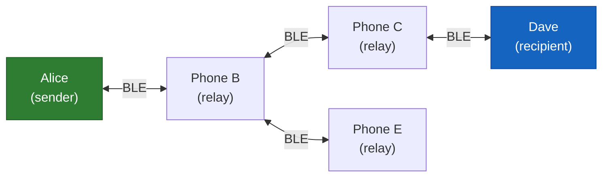
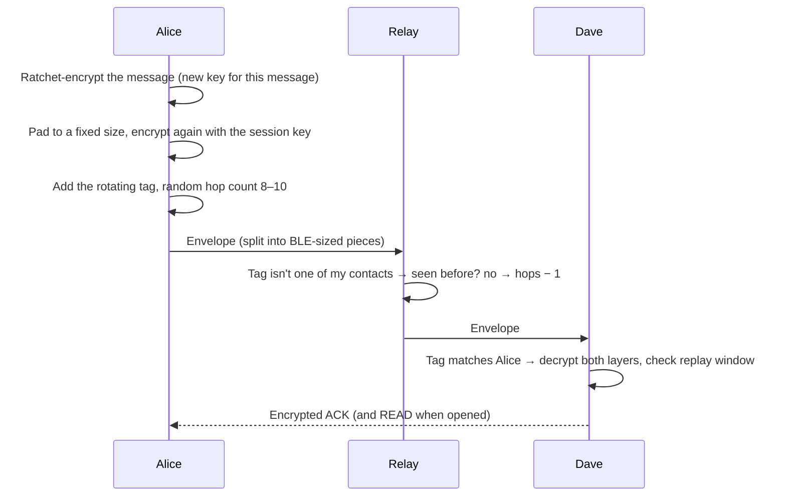
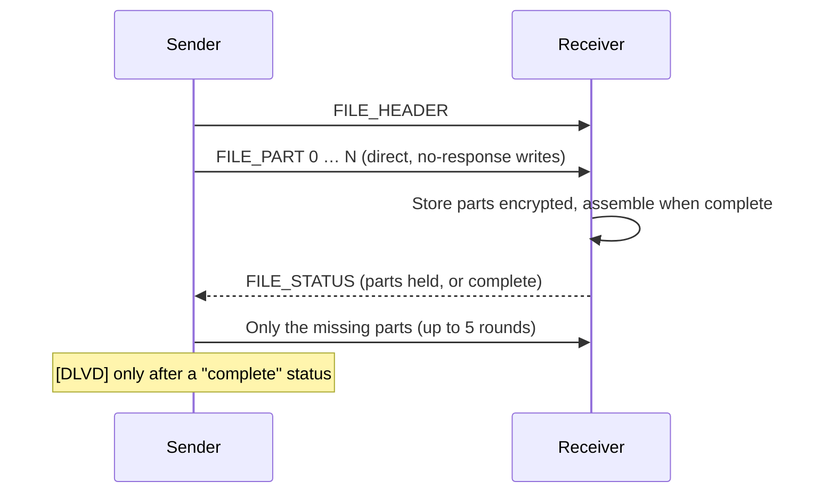

# ComLink 📡

**An offline, end-to-end encrypted Bluetooth mesh messenger for Android.**
No internet, no SIM, no servers, no accounts. Phones talk to each other over Bluetooth Low Energy, and messages hop from phone to phone until they reach the right person.


> **Alpha software.** ComLink hasn't been released yet. The message format still changes between builds, so every phone you test with needs the same build. It hasn't had an external security audit. Please don't rely on it where your safety depends on it.

---

## Contents

- [Why ComLink](#why-comlink)
- [Features](#features)
- [How it works](#how-it-works)
- [Security](#security)
- [Protocol reference](#protocol-reference)
- [Architecture](#architecture)
- [Getting started](#getting-started)
- [Using ComLink](#using-comlink)
- [Testing](#testing)
- [Limitations](#limitations)
- [Contributing](#contributing)
- [License](#license)

---

## Why ComLink

Most messengers stop working the moment the network does: at a festival, on a trek, during a power cut or a disaster, or anywhere the internet is blocked or watched. ComLink needs nothing but the phones themselves.

- **Off-grid:** every phone running ComLink is both a client and a relay. A message to someone out of range is carried by the phones in between.
- **Private by design:** relays can't read messages, and they can't even tell who is talking to whom. Envelopes carry no sender or recipient ID, only a tag that changes every 15 minutes.
- **No account, no server:** your identity is a key pair made on your phone. You add contacts in person by scanning a QR code.

---

## Features

### Messaging
- One-to-one encrypted chats over a Bluetooth LE mesh, relayed through other ComLink phones (up to 10 hops).
- Delivery status on every message: `[WAIT]` → `[SENT]` → `[DLVD]` (delivered) → `[SEEN]` (read).
- Replies with a quoted snippet, copying text, and automatic retries. A message stuck on `[WAIT]` can also be retried by hand.
- **Saved Messages:** a private, local-only chat for notes and for messages you want to keep.
- Pin chats to the top, and give contacts a nickname.

### Files and location
- Send **images, videos, audio and documents** up to **10 MB**. Large photos are shrunk to 1920 px JPEG first.
- Files travel as encrypted 100 KB parts. The receiver reports which parts it holds, so only missing parts are sent again.
- **Jumpstart:** a stuck transfer asks the receiver what it already has and sends only the rest.
- **Save to device:** long-press any image, video, audio file or document to save it anywhere through Android's own "Save as" screen.
- **Location sharing:** send your coordinates; the other side opens them in any maps app.

### Contacts and presence
- Add a contact by scanning their QR code. Compare **key fingerprints** to be sure you scanned the right person.
- Online / offline status that can't be faked: a contact only shows `[ONLINE]` after their encrypted presence message decrypts.

### Running in the background
- **Background delivery** (on by default, switch in Settings): a foreground service keeps the mesh running while the app is closed, so messages arrive and get relayed instantly. Turn it off to save battery; messages then wait until you open the app.

### Security and storage
- End-to-end encryption with **forward secrecy** (a Double Ratchet), inside a second layer that hides the ratchet's keys from relays. See [Security](#security).
- The chat database is encrypted with **SQLCipher**. Every stored file is encrypted with **Tink**.

### Look and feel
- A terminal-style "cypherpunk" interface built with Jetpack Compose, with your own display name and accent colour.
- Edge-to-edge layout on Android 15+, and it works from Android 8.0 up.

---

## How it works

### The mesh

Every phone is a BLE **GATT server and client at the same time** ("dual role"): it advertises itself, scans for others, and connects to every ComLink phone in range.



Alice and Dave are out of range of each other. Alice's message goes to B. B checks the envelope's tag against its own contacts, finds no match, lowers the hop count and passes it on. C does the same. Dave's phone recognises the tag as Alice's and opens it. B and C never learn who sent it, who it's for, or what it says.

### The journey of one message



1. **Sealing:** the message is encrypted with the chat's Double Ratchet (its own one-use key). The result is padded to a fixed size and encrypted again with the session key both phones derived from their QR keys.
2. **Addressing:** instead of names, the envelope carries a 16-byte tag that only Alice and Dave can compute, and that changes every 15 minutes.
3. **Transport:** the envelope is serialised with Protobuf and split into pieces that fit each connection's negotiated MTU.
4. **Relaying:** each phone that doesn't recognise the tag relays it once (duplicates are dropped), with one hop less. The hop count starts at a random 8–10, so it doesn't reveal how far away the sender is.
5. **Delivery:** Dave's phone matches the tag, decrypts, checks the replay window, and shows the message. The ACK travels back the same way.

---

## Security

### Identity and contacts
- Each phone makes a long-term **X25519** key pair on first launch. The private key is wrapped by a key in the **Android Keystore** (through Tink) and never leaves the phone.
- A contact's QR code holds their device ID, public key and display name. Only a valid 32-byte key is accepted, so a random QR code can't become a contact.
- **Verify fingerprints:** the scan dialog shows the scanned key's fingerprint (SHA-256, in groups of 4). Compare it with the one under the other person's QR code to rule out a swapped QR code.

### Two layers of encryption

```
┌──────────────────────── Envelope (what relays see) ─────────────────────────┐
│ tag (16 B, rotates every 15 min) · envelope ID · timestamp · type · hops     │
│ ┌──────── Outer layer: AES-256-GCM, session key, header as AAD ───────────┐ │
│ │ padded to 256 B / 1 / 4 / 16 / 32 / 64 / 100 KB                          │ │
│ │ ┌────── Inner layer: Double Ratchet, one key per message ─────────────┐ │ │
│ │ │ ratchet key · message numbers · AES-256-GCM(message)                 │ │ │
│ │ └──────────────────────────────────────────────────────────────────────┘ │ │
│ └──────────────────────────────────────────────────────────────────────────┘ │
└──────────────────────────────────────────────────────────────────────────────┘
```

**Outer layer (session cipher).** Both phones derive the same session key from their two X25519 keys with HKDF-SHA256. Every envelope is encrypted with **AES-256-GCM**:
- **Nonces never repeat.** The nonce is built from a session salt, a direction byte and a 24-bit counter. All sending goes through one locked path (`EncryptedSender`), so a counter is never used twice, and sending stops before the counter could wrap.
- **Headers can't be altered.** The header (tag, envelope ID, content type, timestamp) is bound to the ciphertext as associated data, so a relay that changes any of it breaks decryption. Only the hop count is left out, because relays must lower it.
- **Sizes don't give anything away.** Every payload is padded to one of 7 fixed sizes, so relays can't tell a text from a read receipt by its length.
- **Replays are dropped.** A sliding **replay window** of 256 counters accepts messages that arrive out of order through the mesh and drops anything already seen.

**Inner layer (Double Ratchet, forward secrecy).** Every message except presence also goes through a **Double Ratchet**: Signal's published algorithm, written on Tink.
- **Old messages stay safe.** Each message has its own key, and used keys are deleted, so a key stolen later can't open earlier messages.
- **A thief gets locked out again.** Every reply mixes in a fresh X25519 exchange, so someone who stole a key loses access after the next reply.
- **It works on a mesh.** Messages can arrive late, out of order or twice. Keys for messages that haven't arrived yet are kept for up to 7 days (at most 1,000 per contact).
- **It starts with no server.** It starts from the QR-code keys. The phone with the lower public key starts the first key exchange, and either side can send first.
- **Relays never see it.** The ratchet runs inside the outer layer, so relays never see its keys (which would otherwise link messages over time).

### Hiding who talks to whom
- **No IDs on the wire.** Envelopes carry no sender or recipient ID. The **tag** is HMAC-SHA256 of a key only the two contacts share, the direction and the 15-minute window, cut to 16 bytes. Only the recipient can match it, and the match itself identifies (and decryption proves) the sender. Tags from the previous, current and next window are accepted, so clocks may be 15 minutes apart.
- **`HELLO` and `PING` name nobody:** they only say "a ComLink phone is here".
- **Presence proves who's nearby.** A new neighbour gets an encrypted **PRESENCE** for each contact (at most once a minute), and only the right contact can read theirs. A contact is shown online, and gets direct sends, only after their presence decrypts. Nobody can fake someone being online or redirect their messages.

### Protecting the mesh
- **Hop limit:** at most 10 hops, enforced by every relay, so an envelope can't circulate forever.
- **Flood limit:** each neighbour may get at most 20 envelopes relayed per 10 seconds. One phone can't make the mesh repeat a flood, and other neighbours aren't affected.
- **Bounded memory:** incoming pieces are reassembled per sending device, with size checks and expiry, so one device can't corrupt or exhaust another's transfers.
- **Safe file handling:** file headers and parts are checked before anything touches disk. Only canonical UUIDs are accepted (no `../`), sizes and part counts must be within limits, and parts are taken only from the contact who sent the header.

### On the phone
- **The database is encrypted.** The chat database is encrypted with **SQLCipher**. Its random passphrase is wrapped by the Keystore key. Installs from before encryption are moved over once, in the background, and the encrypted copy is checked row by row before the plain one is deleted.
- **Stored files are encrypted.** Every stored file is encrypted with **Tink streaming AEAD** (AES-256-GCM-HKDF): received files, sent copies, thumbnails and partial transfers. Opening a file in another app uses a temporary decrypted copy, deleted on the next app start.
- **No cloud backup.** Android backup is turned off, so chats and keys never leave the phone in a cloud backup.

### What others can still see

| Who | What they can learn |
|---|---|
| Relays and Bluetooth listeners | That ComLink phones are nearby; each envelope's timestamp, content type, padded size and hop count |
| Relays | Envelopes in one direction of one chat within one 15-minute window share a tag, so they can be grouped for that window (not across windows, and not with the replies) |
| A new neighbour | Roughly how many contacts a phone has (one presence message per contact) |
| Someone who records traffic and later steals a private key | Only the very first messages of a new chat, sent before either side received anything back. After that, forward secrecy applies |
| Someone with your unlocked phone | Your chats, like any messenger on an unlocked phone |

---

## Protocol reference

### Envelope (`app/src/main/proto/comlink.proto`)

| Field | Type | Meaning |
|---|---|---|
| `ciphertext` (3) | bytes | Outer-layer AES-256-GCM of the padded payload |
| `nonce` (4) | bytes | 12 bytes: session salt (8) + direction (1) + counter (3) |
| `timestamp` (5) | int64 | When the message was written (authenticated) |
| `envelope_id` (6) | string | Random UUID; the message ID for chat messages |
| `ttl` (7) | int32 | Hops left: starts at 8–10, never above 10 |
| `content_type` (8) | int32 | See below (authenticated) |
| `tag` (9) | bytes | 16-byte rotating tag (authenticated) |

Fields 1 and 2 (the old plain-text `sender_id` and `recipient_id`) are reserved and never sent.

### Content types

| Value | Name | Purpose | Ratchet |
|---|---|---|---|
| 0 | `MESSAGE` | Text, location, `ACK:<id>`, `READ:<id>,<id>,…` (up to 40 IDs per receipt) | Yes |
| 1 | `FILE_HEADER` | Name, type, size, part count, thumbnail | Yes |
| 2 | `FILE_PART` | One ≤100 KB part of a file | Yes |
| 3 | `PRESENCE` | "I'm here", 1 hop only | No |
| 4 | `FILE_STATUS` | Bitmap of the parts the receiver holds, or a request for it | Yes |

### Transport
- **Pieces:** an envelope is split into pieces, each with a 6-byte header (packet ID 4 bytes, piece count 1, piece index 1), so at most 255 pieces. Each piece fits one GATT write: MTU − 3 − 6 bytes, at most 500 bytes of data.
- **HELLO and PING:** each new connection sends `HELLO`, and every connection gets a `PING` every 15 seconds. A failed ping drops the connection.
- **Write types:** file parts go directly to the contact's proven connection with no-response writes for speed. Everything else is broadcast to all connections.

### File transfer



If no status arrives within 15 seconds, the sender asks for one. A receiver that never got the header gets the header and every part again.

### Limits at a glance

| Setting | Value |
|---|---|
| Hops | random start 8–10, maximum 10 |
| Relay limit | 20 envelopes per neighbour per 10 s |
| File size | 10 MB (100 KB parts) |
| Padding sizes | 256 B, 1 KB, 4 KB, 16 KB, 32 KB, 64 KB, 100 KB |
| Replay window | 256 messages |
| Tag window | 15 minutes (±1 window accepted) |
| Ratchet: skipped keys | at most 1,000 per step and per contact, kept 7 days |
| Presence | every 30 s to nearby contacts; offline after 75 s of silence |

---

## Architecture

```
┌──────────────────────────────────────────────────────────┐
│ UI        Jetpack Compose, ComLinkViewModel              │
├──────────────────────────────────────────────────────────┤
│ Messaging MessagingEngine (app-wide; MeshService keeps   │
│           it alive) · EncryptedSender · RatchetSessions  │
│           · FileTransferManager                          │
├──────────────────────────────────────────────────────────┤
│ Crypto    SessionCipher · DoubleRatchet · TagDirectory   │
│           · ReplayWindow · IdentityManager               │
├──────────────────────────────────────────────────────────┤
│ Routing   MeshRouter · RelayLimiter                      │
├──────────────────────────────────────────────────────────┤
│ Transport BluetoothService · PacketAssembler             │
│           · PeerAddressBook                              │
├──────────────────────────────────────────────────────────┤
│ Storage   Room on SQLCipher · Tink-encrypted files       │
└──────────────────────────────────────────────────────────┘
```

The messaging engine belongs to the `Application`, not to a screen, so closing a chat never stops messages from arriving.

### Project structure

```
app/src/main/
├── proto/comlink.proto            Wire format (Envelope, FileHeader, FilePart, FileStatus, ...)
└── java/com/aarushchaudhary/comlink/
    ├── ComLinkApp.kt              Starts identity, database, router, Bluetooth and the engine
    ├── MainActivity.kt            Navigation, chat list, contacts, QR screens
    ├── bluetooth/
    │   ├── BluetoothService.kt    Dual-role BLE: advertise, scan, connect, send, heartbeat
    │   ├── PacketAssembler.kt     Splits envelopes into pieces and reassembles them per sender
    │   ├── MeshRouter.kt          "Is this for me?", deduplication, relaying with hop limit
    │   ├── RelayLimiter.kt        Per-neighbour relay rate limit
    │   └── PeerAddressBook.kt     Bluetooth addresses proven by a contact's presence
    ├── crypto/
    │   ├── IdentityManager.kt     Keystore-wrapped X25519 identity, database passphrase, file key
    │   ├── SessionCipher.kt       Session key, AES-GCM, nonces, AAD, rotating tags
    │   ├── TagDirectory.kt        Tag → contact lookup for the current ±1 window
    │   ├── DoubleRatchet.kt       The Double Ratchet (forward secrecy)
    │   ├── ReplayWindow.kt        256-message sliding replay window
    │   ├── ContactQr.kt           QR contact parsing and validation
    │   └── Fingerprint.kt         Key fingerprints for verification
    ├── messaging/
    │   ├── MessagingEngine.kt     Sending, receiving, presence, receipts, retries, contacts
    │   ├── EncryptedSender.kt     The one locked send path (counters, both layers, padding)
    │   ├── RatchetSessions.kt     Loads, runs and saves each contact's ratchet
    │   ├── IncomingMessage.kt     Decides what a decrypted envelope is
    │   ├── MeshService.kt         Optional foreground service (background delivery)
    │   └── Padding.kt · ContentTypes.kt · MessagePayloads.kt
    ├── data/
    │   ├── ComLinkDatabase.kt     Room entities and DAO (schemas in app/schemas)
    │   ├── SecureDatabase.kt      Opens SQLCipher; one-time verified move from the plain database
    │   ├── FileTransferManager.kt Sending/receiving files, status, resend, jumpstart, save to device
    │   ├── FileCrypto.kt          Tink streaming encryption of stored files
    │   └── TransferChecks.kt · PartBitmap.kt · FileCopy.kt
    └── ui/                        Compose screens: onboarding, conversation, settings, theme, QR
```

### Tech stack

| Area | Library |
|---|---|
| Language and UI | Kotlin, Jetpack Compose (BOM 2026.06.01), Material 3 |
| Async | Kotlin Coroutines and Flow |
| Database | Room 2.8.5 on SQLCipher 4.20.0 |
| Cryptography | Tink 1.24.0 (X25519, HKDF, streaming AEAD, Keystore), `javax.crypto` AES-GCM and HMAC |
| Serialisation | Square Wire (Protobuf) |
| QR codes | CameraX 1.6.2 (scanning), ZXing 3.5.4 (generating and decoding) |
| Settings | DataStore 1.3.0 |
| Bluetooth | Android `BluetoothGatt`, `BluetoothGattServer`, `BluetoothLeAdvertiser`, `BluetoothLeScanner` |

---

## Getting started

### Requirements
- **Android Studio**: a recent version, with JDK 17.
- **Phones:** Android **8.0 (API 26)** or newer, with Bluetooth LE. The app targets API 36 (Android 16).
- **At least two phones** to chat, and a third to see relaying. Emulators have no Bluetooth, so they can only run the app and its device tests.

### Build and run
```bash
git clone https://github.com/aarushchaudhary/ComLink.git
cd ComLink
./gradlew assembleDebug        # or open the folder in Android Studio and press Run
```
Wire generates the Kotlin classes from `comlink.proto` during the build. The release build is minified with R8, and the needed keep rules are in `app/proguard-rules.pro`.

### Permissions

| Permission | Why | Android versions |
|---|---|---|
| `BLUETOOTH_SCAN` (`neverForLocation`), `BLUETOOTH_ADVERTISE`, `BLUETOOTH_CONNECT` | Find, advertise to and connect to nearby phones | 12+ |
| `BLUETOOTH`, `BLUETOOTH_ADMIN` | The same, on older Android | 8–11 |
| `ACCESS_FINE_LOCATION`, `ACCESS_COARSE_LOCATION` | Bluetooth scanning on Android 11 and older; sharing your location | all |
| `CAMERA` | Scanning contact QR codes | all |
| `POST_NOTIFICATIONS` | The background delivery notice | 13+ |
| `FOREGROUND_SERVICE`, `FOREGROUND_SERVICE_CONNECTED_DEVICE` | Background delivery | 9+ / 14+ |

No storage or microphone permission is needed: files are picked and saved through Android's own pickers.

---

## Using ComLink

1. **First launch:** follow the onboarding, grant the permissions, and set your display name. If you're updating from a build before database encryption, a short **"Securing your chats"** screen appears once while your chats are encrypted.
2. **Add a contact:**
   - One person taps **Show my QR**; the other taps **Scan QR**.
   - Compare the fingerprint in the scan dialog with the one under the QR code, then accept.
   - Do it both ways, so each phone has the other's key.
3. **Chat:** a contact shows `[ONLINE]` when they're nearby (directly or through the mesh). Messages to someone offline wait as `[WAIT]` and are retried automatically when they come back.
4. **Long-press a message** to reply, copy text, save it to Saved Messages, save a file to your device, retry a stuck send, or jumpstart a stuck file transfer.
5. **Attach:** send an image, video, audio file, document, or your current location.
6. **Settings:** change your display name and accent colour, and turn **background delivery** on or off.

---

## Testing

| Suite | Command | What it covers |
|---|---|---|
| Unit tests (116) | `./gradlew testDebugUnitTest` | Session cipher and tags, tag directory, Double Ratchet (out of order, lost, duplicate, restart, stolen key), ratchet storage under concurrency, both layers end to end, send path (nonce uniqueness under 1,000 concurrent sends), replay window, padding, packet framing and reassembly, relay limiting, routing, file checks and encryption, QR parsing, message classification |
| Device tests (5) | `./gradlew connectedDebugAndroidTest` | SQLCipher database move (with real data), fresh install, reopen; ratchet tables and queries |
| Lint | `./gradlew lintDebug` | Includes the Android 8 API check (`NewApi`) |

Full check, as used for every change:
```bash
./gradlew clean assembleDebug assembleRelease testDebugUnitTest assembleDebugAndroidTest lintDebug
```

---

## Limitations

- **Alpha:** the message format can still change, and phones on different builds may not understand each other.
- **One-to-one chats only;** no group chats yet.
- **Range and speed:** Bluetooth LE reaches roughly 10–50 m per hop, and large files are slow. Each extra hop adds delay.
- **No store-and-forward:** a message only travels while a chain of phones connects sender and recipient. Otherwise it waits on the sender's phone and is retried.
- **Battery:** background delivery keeps Bluetooth busy. Turn it off in Settings if battery matters more than instant delivery.
- **Metadata:** see [What others can still see](#what-others-can-still-see).

---

## Contributing

Issues and pull requests are welcome. Before opening a pull request:
- run the full check above;
- keep Android 8.0 (API 26) working, with lint showing 0 `NewApi` issues;
- add or update a unit test for any change to the crypto, routing or file transfer code;
- note any change to the wire format, since it breaks compatibility with older builds.

Security issues: please report them privately through GitHub's **Security → Report a vulnerability** instead of opening a public issue.

---

## License

ComLink is free software under the **GNU General Public License v3.0**. See [LICENSE](LICENSE).

Made by [Aarush Chaudhary](https://github.com/aarushchaudhary).
