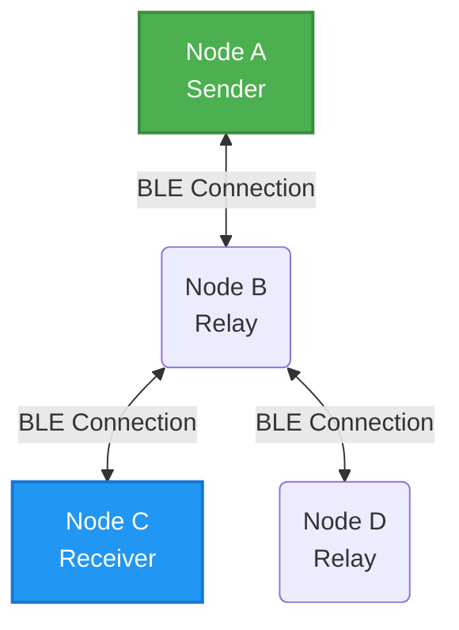
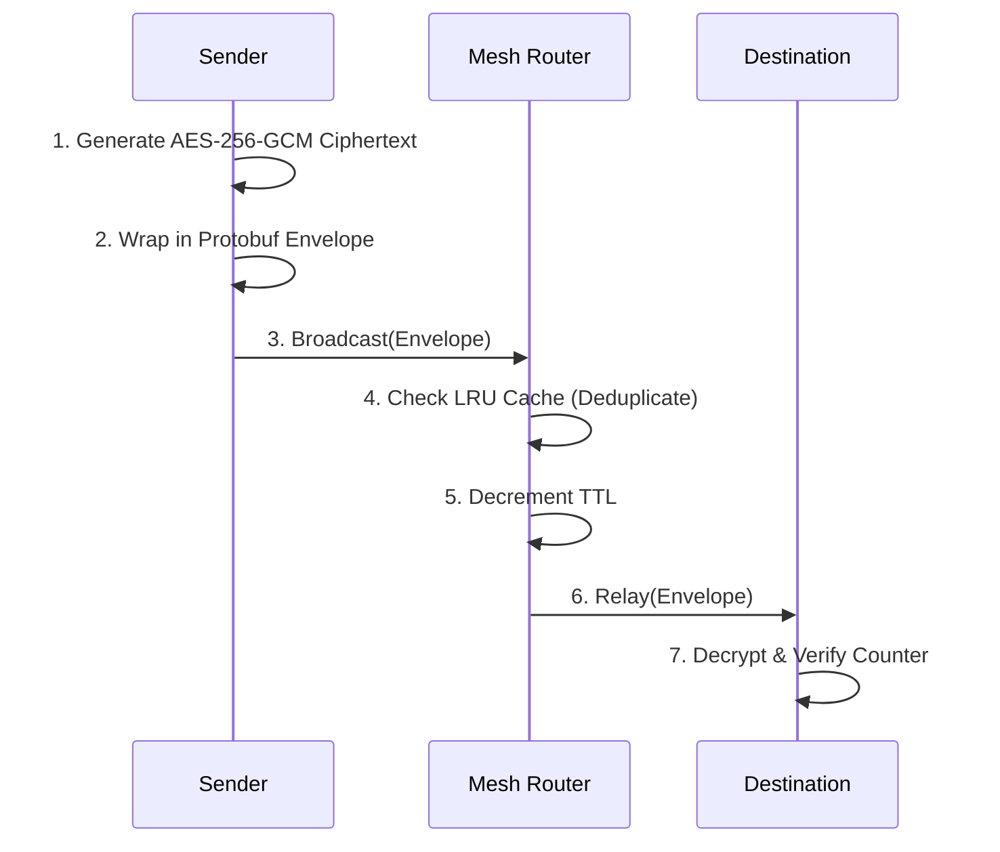
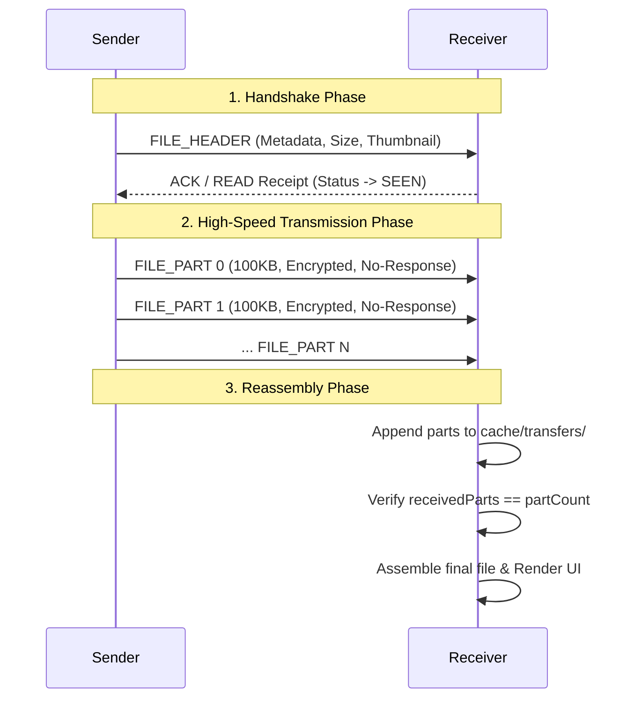

# ComLink 📡

ComLink is a decentralized, offline-first Bluetooth Low Energy (BLE) mesh messenger for Android. It allows devices to communicate securely without relying on cellular networks, Wi-Fi routers, or the internet. Messages and files hop from device to device to reach their destination.

## 🌟 Key Features

*   **100% Offline & Decentralized:** Works completely off-the-grid using BLE GATT connections.
*   **Mesh Routing:** Devices act as nodes. If Alice wants to message Charlie but is out of range, the message will securely hop through Bob (who cannot read it).
*   **End-to-End Encrypted (E2EE):** All payloads are encrypted using AES-256-GCM with ECDH key exchange. Intermediate relay nodes only see ciphertext.
*   **Rich Media Support:** Send images, videos, audio, and documents.
*   **Location Sharing:** Share precise GPS coordinates that render as interactive map links.
*   **Smart File Transfers:** Files are automatically chunked, encrypted, and blasted over BLE using high-throughput No-Response writes. Stuck transfers can be instantly jumpstarted.

---

## 🏗 System Architecture

### Mesh Network Topology
ComLink devices operate in a "Dual-Role" capacity, acting as both BLE GATT Servers and GATT Clients simultaneously. 

*When Node A sends a message to Node C, Node B receives it, checks the `recipient_id`, sees it is not the intended target, decrements the TTL (Time-To-Live), and broadcasts it forward.*

### The Protocol Stack
ComLink relies on a custom multi-layered networking stack:

1. **Application Layer (UI & DB):** Jetpack Compose, MVVM, Room Database.
2. **Encryption Layer (`SessionCipher`):** ECDH shared secret derivation, AES-GCM encryption, monotonic replay-protection counters.
3. **Routing Layer (`MeshRouter`):** Protobuf Envelope decoding, deduplication (LRU cache), TTL management, targeted vs. broadcast routing.
4. **Transport Layer (`BluetoothService`):** MTU negotiation, 500-byte packet chunking, payload reassembly, connection mutexing.

---

## 🔒 Security & Data Flow

All communication is wrapped in a Protobuf `Envelope`. Only the `envelope_id`, `sender_id`, `recipient_id`, and `ttl` are visible to the mesh. The actual data is encrypted ciphertext.

---

## 📁 File Transfer Protocol

Transferring large files (like videos) over BLE requires careful orchestration to avoid overwhelming the MTU limits and GATT queues. 

ComLink uses a bespoke streaming protocol. It splits files into ~100KB `FilePart` chunks. To maximize speed, it uses **Targeted Direct Sends** and **`WRITE_TYPE_NO_RESPONSE`**, completely bypassing BLE acknowledgment bottlenecks.

### Jumpstart & Resilience
Because ComLink prioritizes speed over reliability for media chunks (using unacknowledged writes), interference can cause dropped packets.
* If a transfer stalls, the UI provides a **Jumpstart Transfer** option.
* `FileTransferManager` queries the SQLite database for the `lastSentPartIndex`.
* It opens the file via `RandomAccessFile` and blasts only the remaining missing chunks.

---

## 🛠 Tech Stack

* **Language:** Kotlin
* **UI Toolkit:** Jetpack Compose
* **Architecture:** MVVM, Coroutines, Flow
* **Local Storage:** Room Database
* **Serialization:** Square Wire (Protobuf)
* **Cryptography:** `javax.crypto` (AES/GCM/NoPadding, ECDH)
* **Networking:** Android `BluetoothGatt`, `BluetoothLeAdvertiser`, `BluetoothLeScanner`

## 🚀 Setup & Compilation

### Requirements
* Android Studio Iguana (or newer)
* Minimum SDK: 26 (Android 8.0)
* Target SDK: 34 (Android 14)

### Permissions Needed
ComLink requests the following permissions at runtime:
* `BLUETOOTH_SCAN`, `BLUETOOTH_ADVERTISE`, `BLUETOOTH_CONNECT`
* `ACCESS_FINE_LOCATION`, `ACCESS_COARSE_LOCATION` (Required for BLE scanning on older OS versions)
* `READ_MEDIA_IMAGES`, `READ_MEDIA_VIDEO`, `READ_MEDIA_AUDIO`

### Building
1. Clone the repository.
2. Open in Android Studio.
3. Sync Gradle projects.
4. Hit **Run**. Wire will automatically generate the Kotlin classes from the `.proto` schemas during the build.
