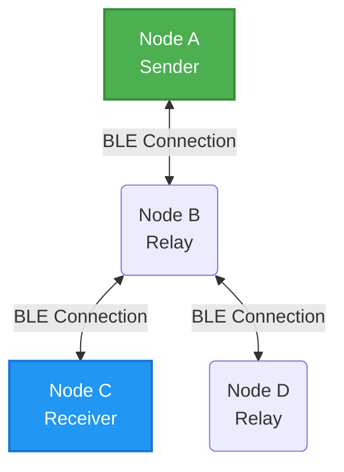
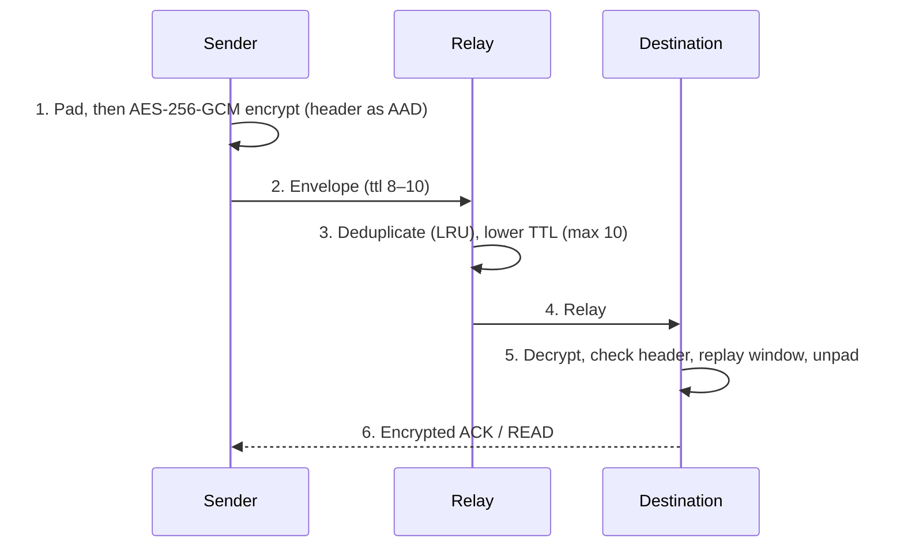
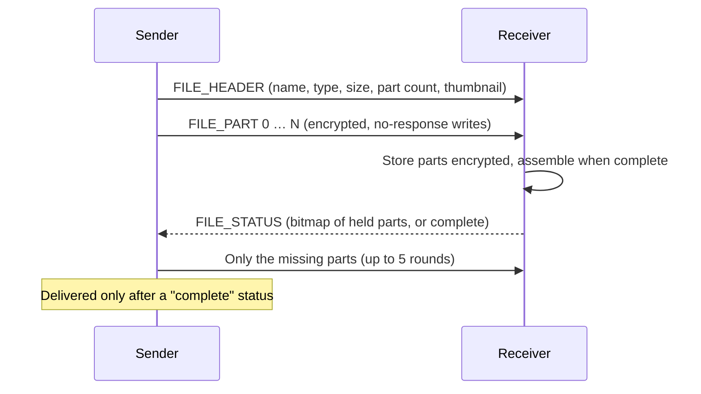

# ComLink 📡

ComLink is a decentralized, offline-first Bluetooth Low Energy (BLE) mesh messenger for Android. It allows devices to communicate securely without relying on cellular networks, Wi-Fi routers, or the internet. Messages and files hop from device to device to reach their destination.

## 🌟 Key Features

*   **100% Offline & Decentralized:** Works completely off-the-grid using BLE GATT connections.
*   **Mesh Routing:** Devices act as nodes. If Alice wants to message Charlie but is out of range, the message will securely hop through Bob (who cannot read it).
*   **End-to-End Encrypted (E2EE):** Every message is encrypted with AES-256-GCM using a key derived from both contacts' X25519 keys. Relay nodes can't read it or change its header without breaking it. See [Security](#-security--data-flow) for exactly what relays can still see.
*   **Rich Media Support:** Send images, videos, audio, and documents.
*   **Location Sharing:** Share precise GPS coordinates that render as interactive map links.
*   **Reliable File Transfers:** Files (up to 10 MB) are split into encrypted 100 KB parts. The receiver reports which parts it holds, so only missing parts are re-sent, and a stuck transfer can be jumpstarted.
*   **Save to Device:** Long-press any image, video, audio file or document to save it anywhere on the phone, through Android's own "Save as" screen.
*   **Background Delivery:** An optional foreground service keeps the mesh running while the app is closed (switch in Settings).
*   **Encrypted Storage:** The chat database (SQLCipher) and every stored file (Tink streaming AEAD) are encrypted at rest.

---

## 🏗 System Architecture

### Mesh Network Topology
ComLink devices operate in a "Dual-Role" capacity, acting as both BLE GATT Servers and GATT Clients simultaneously. 

*When Node A sends a message to Node C, Node B receives it, checks its rotating `tag` against its own contacts, finds no match, decrements the TTL (Time-To-Live), and broadcasts it forward. Envelopes name neither sender nor recipient.*

### The Protocol Stack
ComLink relies on a custom multi-layered networking stack:

1. **Application Layer (UI & DB):** Jetpack Compose, MVVM, Room Database.
2. **Encryption Layer (`SessionCipher`, `EncryptedSender`, `ReplayWindow`):** X25519 + HKDF session keys, AES-256-GCM with the envelope header as AAD, one locked send path so a nonce is never reused, and a 256-message sliding replay window.
3. **Routing Layer (`MeshRouter`):** Protobuf Envelope decoding, deduplication (LRU cache), TTL capped at 10, targeted vs. broadcast routing.
4. **Transport Layer (`BluetoothService`, `PacketAssembler`):** MTU negotiation, per-connection packet sizes, reassembly grouped by sender with bounds checks and expiry, and presence-verified addresses for direct sends.

---

## 🔒 Security & Data Flow

### Keys and contacts
* Each phone has a long-term **X25519** key pair. The private key is wrapped by an Android Keystore key (via Tink) and never leaves the phone.
* Contacts are added by scanning a QR code (device ID, public key, display name). Only a valid 32-byte key is accepted.
* To check you scanned the right person, compare the **key fingerprint** in the scan dialog with the one shown under their QR code.

### Messages
* Both phones derive the same session key from their two keys (X25519 + HKDF-SHA256). Every message is encrypted with **AES-256-GCM**, using a 96-bit nonce built from a session salt, a direction byte and a counter.
* All encryption goes through one locked send path (`EncryptedSender`), so a counter, and with it a nonce, is never used twice. Sending stops before the 24-bit counter could wrap.
* Envelopes carry no sender or recipient ID. Instead each one has a 16-byte **rotating tag**: HMAC-SHA256 of a key only the two contacts share, the direction and the 15-minute window. Only the recipient can match it, so it is also how the recipient knows who sent it. Tags for the previous, current and next window are accepted, so clocks may be up to 15 minutes apart.
* The envelope header (tag, envelope ID, content type, timestamp) is bound to the ciphertext as **AAD**: a relay that changes any of it breaks decryption. Only the hop count (`ttl`) is left out, because relays must lower it.
* Every message is padded to one of 7 fixed sizes (256 B to 100 KiB) before encryption, so relays can't tell a text from a read receipt by its size.
* A **sliding replay window** (256 counters) accepts messages that arrive out of order through the mesh, and rejects anything already seen.

### Presence
* `HELLO`/`PING` name nobody: they only say "a ComLink phone is here". A new neighbour gets an encrypted **PRESENCE** for each contact (at most once a minute), and only the right contact can read theirs. A contact is shown **online**, and gets direct sends, only after their PRESENCE decrypts, so nobody can fake someone being online or redirect their messages.

### Files
* Incoming file headers and parts are checked before anything touches disk: canonical UUIDs only (no `../`), sizes and part counts within limits, and parts only from the contact who sent the header.
* The receiver reports which parts it holds (`FileStatus`). The sender re-sends only missing parts, and shows **Delivered** only when the whole file has arrived.

### Storage on the phone
* The chat database is encrypted with **SQLCipher**. Its passphrase is random and wrapped by the Keystore key. Older installs are moved over once: the encrypted copy is verified row by row before the plain database is deleted.
* Every stored file (received files, sent copies, thumbnails, partial transfers) is encrypted with **Tink streaming AEAD** (AES-256-GCM-HKDF). Opening a document in another app uses a temporary decrypted copy that is deleted on the next app start.

### What relays and nearby listeners can still see
* Envelopes between the same two contacts in the same 15-minute window share a tag, so they can be grouped for that window (not across windows, and not with the replies).
* The timestamp, the content type and the padded size of each envelope.
* Roughly how many contacts a phone has: a new neighbour receives one PRESENCE per contact.
* There is **no forward secrecy** yet: someone who records traffic and later steals a private key can decrypt it. This is planned as future work (a Double Ratchet).

---

## 📁 File Transfer Protocol

Files are split into ~100 KB `FilePart`s. Parts go by **direct send** with `WRITE_TYPE_NO_RESPONSE` for speed, and delivery is confirmed per part.

### Jumpstart & Resilience
* If no status arrives, the sender asks for one, and a receiver that never got the header gets the header and every part again.
* **Jumpstart** first asks the receiver which parts it already holds and sends only the rest.
* Files over 10 MB are refused up front with a message, and large photos are shrunk to 1920 px JPEG before sending.

---

## 🛠 Tech Stack

* **Language:** Kotlin
* **UI Toolkit:** Jetpack Compose
* **Architecture:** MVVM, Coroutines, Flow; an app-wide `MessagingEngine` and an optional foreground `MeshService`
* **Local Storage:** Room on **SQLCipher**; files encrypted with **Tink** streaming AEAD
* **Serialization:** Square Wire (Protobuf)
* **Cryptography:** Tink (X25519, HKDF, Keystore-wrapped keys), `javax.crypto` (AES/GCM/NoPadding)
* **Networking:** Android `BluetoothGatt`, `BluetoothLeAdvertiser`, `BluetoothLeScanner`

## 🚀 Setup & Compilation

### Requirements
* Android Studio (recent)
* Minimum SDK: 26 (Android 8.0)
* Target SDK: 36 (Android 16)

### Permissions Needed
ComLink requests the following permissions at runtime:
* `BLUETOOTH_SCAN`, `BLUETOOTH_ADVERTISE`, `BLUETOOTH_CONNECT` (Android 12+)
* `ACCESS_FINE_LOCATION`, `ACCESS_COARSE_LOCATION` (BLE scanning on Android 11 and older, and location sharing)
* `CAMERA` (QR scanning) and `POST_NOTIFICATIONS` (Android 13+, background delivery notice)

No storage or microphone permission is needed: files are picked and saved through the system pickers.

### Tests
* Unit tests: `./gradlew testDebugUnitTest` (crypto, replay window, padding, packet framing, file checks, file encryption, QR parsing).
* On a device: `SecureDatabaseMigrationTest` (Android Studio → right-click → Run) checks the encrypted database move.

### Building
1. Clone the repository.
2. Open in Android Studio.
3. Sync Gradle projects.
4. Hit **Run**. Wire will automatically generate the Kotlin classes from the `.proto` schemas during the build.
